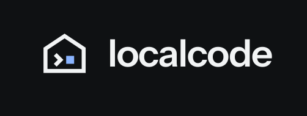
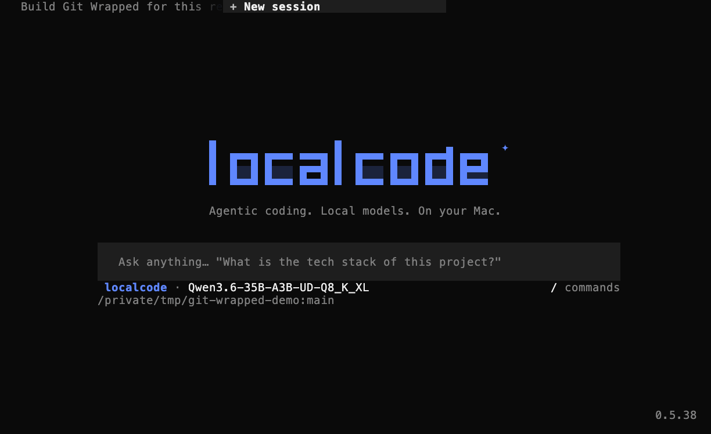

<p align="center">
  
</p>

<p align="center">
  
  
  
  
</p>

<p align="center">
  <strong>Agentic coding. Local models. On your Mac.</strong>
</p>

<p align="center">
  
</p>

## Install

```bash
uv pip install localcode
```

Upgrade with `uv pip install -U localcode`.

## Run

```bash
cd your-project
localcode
```

To use the running model from another local app, open `/server` or run `localcode api` for its
OpenAI compatible endpoint. See the [Local API guide](https://mjwsolo.github.io/localcode/guides/local-api/).

## What it does

- Reads and edits files in your project
- Runs your tests, builds, Git and shell commands inside the project on its own, and asks before touching anything outside it
- Searches code by name, content or structure
- Scaffolds and launches apps, then checks that they respond
- Remembers the task across messages

## Requirements

- Mac with Apple Silicon, macOS 13 or newer
- 16 GB unified memory or more
- Python 3.10 or newer
- Disk space for LocalCode and your chosen model (download sizes below)

## Models

Choose from **12 models and 169 quant options** for coding, image input and typed decisions. Models download from Hugging Face. Downloads run in parallel and can resume if interrupted. Switch with `/models`. LocalCode recommends the most capable one that fits your Mac's memory and marks it with a star.

Speed: Gemma 4, Qwen 3.6, Muse Glimmer and Qwen 3.8 draft tokens with the vendor's own speculative drafter, which downloads with the model. The model server's GPU kernels ship precompiled, so the first start after an install is quicker.

| Model | Smallest download | Largest download |
| --- | ---: | ---: |
| [Gemma 4 12B](https://huggingface.co/unsloth/gemma-4-12b-it-GGUF) | 4.7 GB | 24.3 GB |
| [Qwen 3.8 27B](https://huggingface.co/unsloth/Qwen3.8-27B-GGUF) | 6.2 GB | 54.7 GB |
| [Inkling 2 Mini 26B-A5B](https://huggingface.co/unsloth/Inkling-2-Mini-GGUF) | 7.8 GB | 22.9 GB |
| [North-Mini-Code 30B-A3B](https://huggingface.co/unsloth/North-Mini-Code-1.0-GGUF) | 9.4 GB | 61.0 GB |
| [Gemma 4 26B-A4B](https://huggingface.co/unsloth/gemma-4-26B-A4B-it-GGUF) | 10.4 GB | 51.0 GB |
| [Qwen 3.6 35B-A3B](https://huggingface.co/unsloth/Qwen3.6-35B-A3B-GGUF) | 10.5 GB | 69.8 GB |
| [Flint 40B-A2.5B](https://huggingface.co/unsloth/flint-GGUF) | 11.4 GB | 79.6 GB |
| [Muse Glimmer 30B](https://huggingface.co/unsloth/Muse-Glimmer-30B-GGUF) | 12.4 GB | 57.4 GB |
| [Gemma 4 Diffusion 26B-A4B](https://huggingface.co/unsloth/diffusiongemma-26B-A4B-it-GGUF) | 16.8 GB | 50.5 GB |
| [OpenJev 27B (decisions)](https://huggingface.co/ggml-org/OpenJev-GGUF) | 19.4 GB | 53.8 GB |
| [Kolibri 1 78B-A3B](https://huggingface.co/Hob-forge/Kolibri-1-GGUF) | 28.6 GB | 83.1 GB |
| [DeepSeek V4 Flash 284B-A13B](https://huggingface.co/unsloth/DeepSeek-V4-Flash-Vision-Exp-GGUF) | 82.4 GB | 161.9 GB |

## Optimisations

What LocalCode adds on top of the stock model server to make local models faster and better at coding.

Speed
- Drafting: the vendor's own drafter guesses tokens ahead (about 2x faster replies on Gemma 4, Qwen 3.6, Qwen 3.8 and Muse Glimmer)
- Copy drafting: when the model rewrites a file it already read, it copies instead of generating (3.5 to 4x faster on rewrites)
- Prompt cache reuse: the system prompt stays the same every turn, so the model only reads what is new
- Warm-up: the first request's prompt is read while the model loads, so your first message starts sooner
- Precompiled GPU kernels: no half-minute shader compile on first start
- Threads matched to your Mac's performance cores
- Flash attention on by default
- Inkling 2: its experts run on the GPU (were silently on the CPU, about 5x slower), banded attention and a fused activation op halve its GPU memory and read prompts 20 to 30% faster
- Downloads run in parallel, resume if interrupted, and keep going while you use another model

Memory
- 8-bit KV cache by default: half the memory of full precision, so longer context fits
- Context sized from what the server reports, so long chats compact before they run out of room
- The picker recommends the most capable model that fits your Mac

Quality
- Hidden thinking off by default, so answers come straight away; a model that gets stuck thinking is recovered instead of failing
- Plan panel: the model keeps a task list and is reminded to update it
- Stuck detection: a model that makes no progress, or keeps failing the same check, is nudged to change approach and then stopped so it reports what it has
- Every release is tested live on every model (load, reply, tool calls, images) before it ships

## Network

Inference is local. Three features use the network: model downloads, the `web_search` and `web_fetch` tools, and any MCP servers you add. See [Network Boundary](https://mjwsolo.github.io/localcode/concepts/network-boundary/) for the full list.

## Why local?

Powerful, personal AI should work for everyone, on any device, anywhere. That means running it locally. localcode is a first step.

## Sponsors

To sponsor localcode, [reach out](https://github.com/mjwsolo/localcode).

## Contributing

See [CONTRIBUTING.md](CONTRIBUTING.md).

## License

Apache 2.0. See [LICENSE](LICENSE).
